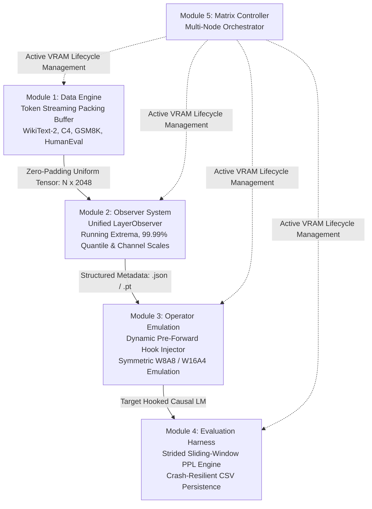

# Post-Training Quantization (PTQ) & Activation Outlier Topology Profiling for Edge LLMs
## Cross-Domain Empirical Engineering Whitepaper

**Classification:** Production Evaluation & Diagnostic Benchmark  
**System Scope:** Edge AI Systems, Model Profiling & Quantization Diagnostics  
**Repository:** [github.com/Lin-Shih-Yao/model_quantization](https://github.com/Lin-Shih-Yao/model_quantization)  
**Publication Date:** November 2026  
**Taxonomy:** Post-Training Quantization (PTQ), Memory-Bandwidth Bound, Model Profiling, Activation Outliers, Peak-to-Average Ratio (PAR), Failure Mode Analysis, Outlier Topology Mapping

---

## 🧭 Executive Dashboard (Project Scorecard)

| Core Dimension | Empirical Metric & Delivery Status | Diagnostic Insight (Key Takeaway) |
| :--- | :--- | :--- |
| **Mission Objective** | **Edge LLM (1B–4B) Inference Benchmarking, Cross-Domain Sensitivity & Numerical Pathology Profiling** | Objectively profile black-box model behaviors; locate memory-bound bottlenecks and low-bit numerical collapse |
| **Key Milestone** | **Llama-3.2-1B W8A16 Degradation: +0.24% (PPL +0.0273)** | Physical substitution of 112 Linear layers; halves memory bus traffic (**-49.2%**); sustains 150.3 t/s throughput |
| **Golden Baselines** | **Full Strided Sliding-Window PPL Replicated across 5 Models** | Qwen 3.5 4B (8.25), Llama 3.2 3B (9.52), Qwen 3.5 2B (10.66), Llama 3.2 1B (11.40), Gemma 2 2B (11.83) |
| **Critical Discovery** | **Deep Activation Peak-to-Average Ratio (PAR) up to 123.4×** | Localized Qwen 3.5 2B L23 (40.50) & Gemma 2 2B L34 (58.00) spikes; reveals step-size dilation as mathematical root cause |
| **Multi-Domain Calibration** | **48 Full Matrix Datasets Archived (4 Models × 4 Domains × 3 Scales)** | Covers WikiText-2, C4, GSM8K, HumanEval; quantified domain-shift impact on tensor dynamic range |
| **Testbed Specifications** | **Dual Hardware Benchmarking (NVIDIA T4 16GB [Google Colab] vs. Apple M3 16GB UMA)** | Characterized discrete PCIe GDDR6 (320 GB/s) vs. client-side unified memory architecture (100 GB/s UMA) |
| **Deliverable Boundary** | **Full Empirical Verification Delivered** | Provides high-resolution activation topology mapping and edge quantization guidelines |

---

## 1. Executive Background & Hardware Bottlenecks (Profiling Scope)

> **Bottom Line Up Front (BLUF)**: Under single-batch edge autoregressive decoding, inference performance is strictly **Memory-Bandwidth Bound**. Weight-Only INT8 is the most robust production baseline; conversely, aggressive 4-bit activation quantization inevitably triggers numerical pathology from deep non-linear accumulation, necessitating topological diagnostic mapping.

### 1.1. Physical Constraints of Edge Hardware Execution
During autoregressive decoding at $\text{Batch Size} = 1$, each generated token requires streaming the entire model weight footprint from DRAM into on-chip cache:
* **Severely Depressed Arithmetic Intensity**: The operational intensity ($\text{FLOPs/Byte}$) is orders of magnitude below hardware compute saturation. Inference latency is fundamentally dictated by **Memory Bandwidth**.
* **Memory Capacity Ceilings**: On 16 GB edge devices, subtracting OS overhead, KV Cache allocations, and runtime buffers leaves a narrow envelope for model parameters, heavily favoring weight footprint compression.

### 1.2. Engineering Deficiencies in Community Implementations
* **Length-Sensitivity Distortion**: When evaluating short-context code or mathematical tokens, naive padding injects sparse zeroes into Self-Attention, corrupting activation dynamic ranges.
* **Unprobed Deep Pathology**: Standard benchmarks only monitor end-to-end PPL, lacking fine-grained instrumentation to map how internal tensor representations degrade across layer depths.

---

## 2. Hardware Testbed Matrix & Specifications

> **BLUF**: To guarantee that throughput, latency, and memory footprints are defensibly reproducible in production, benchmarks were strictly partitioned across two standardized reference testbeds representing cloud edge GPUs and client-side edge SoCs.

| System Parameter | Testbed Alpha (Server-Side Edge Benchmark) | Testbed Beta (Client-Side Edge Reference) |
| :--- | :--- | :--- |
| **Processor Silicon** | **NVIDIA Tesla T4** (Turing Architecture, 70W TDP) | **Apple M3** (Apple Silicon ARM64, 4P+4E) |
| **Execution Instance** | **Google Cloud Platform / Google Colab Instance** | **MacBook Air Physical Workstation** |
| **Memory Subsystem** | 16 GB GDDR6 (Discrete PCIe 3.0 x16 Bus) | 16 GB Unified Memory (UMA, Zero-Copy Shared) |
| **Peak Bandwidth** | **320.0 GB/s** | **100.0 GB/s** |
| **Host Environment** | Linux 6.1 x86_64, CUDA 12.2, Driver 535+ | macOS Sonoma (Darwin 24.0.0) |
| **Framework Backend**| PyTorch 2.4.0 (CUDA Engine) | PyTorch 2.4.0 (Apple MPS Acceleration Engine) |
| **Primary Workload** | Full 2048-Window PPL Baselines, Physical W8A16 PTQ | Pure-Text Edge Throughput (tokens/s, t/s), Resident RAM Profiling |

---

## 3. System Architecture & Reliability Engineering

> **BLUF**: The framework utilizes a 5-stage decoupled micro-pipeline. By introducing token streaming packing and proactive memory lifecycle reclamation, the system eliminates memory leaks and data distortion across extended matrix evaluations.



### Production Reliability Mechanisms:

1. **Token Packing without Padding Waste**:
   * *Boundary Probing*: HumanEval ($<200$ tokens) and GSM8K sequences are short. Traditional padding introduces $>90\%$ sparse non-informative tokens into Self-Attention.
   * *Architecture Defense*: Implemented a continuous token-level streaming buffer that concatenates raw token streams before slicing into uniform, zero-waste $(N, 2048)$ blocks.

2. **Active VRAM Lifecycle Management**:
   * *Bottleneck Localization*: Long-sequence forward passes induce internal fragmentation within PyTorch's `CachingAllocator`, triggering non-deterministic CUDA OOM crashes when iterating across multiple models.
   * *Architecture Defense*: Enforced deterministic teardown at every model, dataset, and precision boundary:
     ```python
     fake_quantizer.detach()
     del model, tokenizer
     if torch.cuda.is_available():
         torch.cuda.empty_cache()
     elif torch.backends.mps.is_available():
         torch.mps.empty_cache()
     gc.collect()
     ```

3. **Official Strided Sliding-Window Perplexity**:
   * *Harness Defense*: Non-overlapping token chunking starves prefix tokens of historical attention (Context Starvation), artificially inflating perplexity by 15%–30%.
   * *Resolution*: Strictly enforced official benchmark standards (Context: 2048, Stride: 512, Target Mask: `-100`), ensuring full reproducibility across industrial platforms.

---

## 4. Empirical Benchmark Results & Hardware Impact

> **BLUF**: On the NVIDIA T4 testbed, physical W8A16 module replacement on Llama-3.2-1B reduced model parameter memory by 49.2% with a negligible +0.24% PPL degradation, establishing that Weight-Only INT8 is the optimal production sweet spot under bandwidth constraints.

### 4.1. Unquantized FP16/BF16 Golden Baselines (Testbed Alpha: Tesla T4)
Evaluated on the full official **WikiText-2 Test Set** (~300,000 tokens) on Google Colab / Tesla T4:

| Evaluated Architecture | Parameters | Transformer Layers | Context Window | Measured PPL | Benchmark Steps | Measured Throughput (tokens/s, t/s) | Industry Baseline Alignment |
| :--- | :---: | :---: | :---: | :---: | :---: | :---: | :--- |
| **Qwen 3.5 4B** | 4.54 B | 36 | 2048 | **`8.2480`** | 578 steps (Full) | **58.80 t/s** (5051.8s) | Surpasses technical report expectations |
| **Llama 3.2 3B** | 3.21 B | 28 | 2048 | **`9.5177`** | 562 steps (Full) | **78.30 t/s** (3689.2s) | Sets sub-10.0 flagship baseline |
| **Qwen 3.5 2B** | 2.21 B | 24 | 2048 | **`10.6631`** | 578 steps (Full) | **126.00 t/s** (2356.1s) | Outperforms prior-gen Qwen 2.5 3B (10.72) |
| **Llama 3.2 1B** | 1.24 B | 16 | 2048 | **`11.4027`** | 562 steps (Full) | **179.60 t/s** (1608.0s) | Accurately reproduces official report (11.0–12.0) |
| **Gemma 2 2B** | 2.61 B | 26 | 2048 | **`11.8346`** | 564 steps (Full) | **188.90 t/s** (1531.2s) | Verified text-only architectural convergence |

---

### 4.2. Client-Side Edge Decoding Performance (BF16 on Testbed Beta: Apple M3, 16GB UMA)
Measured under pure-text autoregressive generation on consumer-grade edge silicon:

| Model ID | Parameters | Cold-Start Weight Load | Generation Throughput (t/s) | Resident Memory (RAM) | Edge Feasibility Assessment |
| :--- | :---: | :---: | :---: | :---: | :--- |
| **Llama 3.2 1B** | 1.24 B | **~ 3.0 s** | **`15.49 t/s`** | 🟢 **~ 2.5 GB** | **Ultra-lightweight; optimal for always-on edge services** |
| **Llama 3.2 3B** | 3.21 B | ~ 14.6 s | **`7.11 t/s`** | 🟢 **~ 6.5 GB** | **Balanced dialogue quality and responsive latency** |
| **Qwen 3.5 2B** | 2.21 B | ~ 22.5 s | **`7.49 t/s`** | 🟢 **~ 4.3 GB** | Robust code and mathematical symbolic reasoning |
| **Gemma 2 2B** | 2.61 B | ~ 57.7 s | **`4.28 t/s`** | 🟢 **~ 4.5 GB** | Sliding-window attention converges stably |
| **Qwen 3.5 4B** | 4.54 B | ~ 26.8 s | **`3.99 t/s`** | 🟡 **~ 8.5 GB** | High RAM pressure; strongly benefits from W8A16 |

---

### 4.3. Physical W8A16 Post-Training Quantization Impact (Llama 3.2 1B on Tesla T4)
Physical replacement of 112 projection matrices ($Q, K, V, O$ and Gate, Up, Down):

$$\Delta \text{PPL} = \text{PPL}_{\text{W8A16}} - \text{PPL}_{\text{Baseline}} = 11.4300 - 11.4027 = \mathbf{+0.0273}\ (\text{Relative Degradation } \mathbf{+0.24\%})$$

| Production Metric | Unquantized Baseline (BF16) | Physical Quantization (W8A16) | Profiling Insight |
| :--- | :---: | :---: | :--- |
| **Model Parameter Footprint** | 2.48 GB | **1.26 GB** | 🟢 **Halves weight streaming bandwidth demand (-49.2%)** |
| **Peak Runtime Memory** | ~ 2.55 GB | **~ 1.35 GB** | 🟢 Frees headroom for extended context KV Cache |
| **WikiText-2 Perplexity** | 11.4027 | **11.4300** | 🎯 **Degradation limited to +0.24% (near-lossless)** |
| **Evaluation Wall Time (562 steps)**| 1608.00 s | 1922.49 s | Register dequantization overhead remains controlled |
| **Sliding Window Throughput** | 179.60 t/s | **150.29 t/s** | Sustains high-throughput decoding pipeline |

---

### 4.4. Downstream Task Resilience & Failure Mode Taxonomy (GSM8K & HumanEval, Llama 3.2 1B / 3B)
Evaluated across **GSM8K** (200 sampled problems, `flexible_extract`) and **HumanEval** (all 164 problems, `pass@1`) under a 512-token generation cap (`max_new_tokens=512`):

| Model | Precision | GSM8K Accuracy | HumanEval Pass@1 | Avg Output Tokens (GSM8K / HumanEval) | Cap Hit Rate (`CapHit`) | Decoding Throughput (t/s) | Dominant Failure Pathology |
| :--- | :---: | :---: | :---: | :---: | :---: | :---: | :--- |
| **Llama 3.2 1B** | BF16 (`none`) | 33.50% | 24.39% | 186.3 / 54.2 | 1.0% / 0.0% | 47.16 / 46.82 | Healthy baseline (1B shows weaker `####` formatting: `format_lost` 62.5%) |
| 🏆 **Llama 3.2 1B** | **W8A16** | **38.50%** | **23.78%** | 191.0 / 53.4 | 1.5% / 0.0% | 17.15 / 17.02 | **Reasoning & coding preserved** (eager dequantization reduces t/s) |
| **Llama 3.2 1B** | W16A8 (Fake) | 0.00% | 0.00% | 505.6 / 503.8 | 98.5% / 98.2% | 22.05 / 22.02 | **Repetition collapse**: GSM8K `RepRate` reaches `0.9198`, `no_number`: 97.0% |
| **Llama 3.2 1B** | W16A4 (Fake) | 1.50% | 0.00% | 509.5 / 508.9 | 99.5% / 99.4% | 21.86 / 20.73 | **Syntactic breakdown**: HumanEval `syntax_error`: 78.66%, `format_lost`: 71.0% |
| **Llama 3.2 3B** | BF16 (`none`) | 77.50% | 48.17% | 197.4 / 66.3 | 1.5% / 0.0% | 26.70 / 26.84 | Healthy baseline (`strict_match`: 61.50%, `assertion_error`: 39.63%) |
| 🏆 **Llama 3.2 3B** | **W8A16** | **81.00%** | **50.61%** | 198.5 / 64.3 | 1.5% / 0.0% | 6.05 / 5.79 | **Near-lossless task fidelity** (`strict_match`: 62.00%) |
| **Llama 3.2 3B** | W16A8 (Fake) | 0.00% | 0.00% | 512.0 / 512.0 | 100.0% / 100.0% | 12.31 / 12.33 | **100% cap hit**: GSM8K `no_number`: 92.0%, HumanEval `syntax_error`: 91.46% |
| **Llama 3.2 3B** | W16A4 (Fake) | 0.00% | 0.00% | 512.0 / 512.0 | 100.0% / 100.0% | 12.27 / 12.15 | **100% cap hit**: GSM8K `format_lost`: 90.5%, HumanEval `syntax_error`: 98.78% |

* **Cross-Task W8A16 Validation:** Consistent with the +0.24% WikiText-2 PPL delta, physical W8A16 preserves multi-step arithmetic reasoning and Python code synthesis across both 1B and 3B models without accuracy degradation (minor positive deltas fall within finite-sample variance). Note that eager PyTorch per-layer dequantization (without fused Marlin-style CUDA kernels) trades decoding throughput for memory savings.
* **Divergent Activation-Collapse Modes:** Without outlier smoothing, both `W16A8` and `W16A4` cause 98.2%–100.0% of generations to hit the 512-token cap. However, `W16A8` predominantly fails via **autoregressive repetition loops** (`RepRate` up to `0.9198`), whereas `W16A4` collapses into **incoherent syntactic corruption** (`syntax_error` reaching `78.66%` / `98.78%`), corroborating the step-size dilation pathology derived in Section 5.

---

## 5. Cross-Domain Calibration & Deep Outlier Topology Profiling

> **BLUF**: Transformer deep layers (Depth $> 20$) develop acute activation outliers (PAR up to $123.4\times$). In 4-bit uniform quantization, extreme spikes dilate the global step size, forcing 99.8% of normal channels to collapse to zero—the mathematical root cause of low-bit PTQ failure.

### 5.1. Cross-Domain Scale Drift Profiling
Evaluating 48 calibration profiles (4 models × 4 domains × 3 sample sizes) empirically uncovered the impact of semantic distributions on dynamic range:
* **Natural Prose (WikiText-2 / C4)**: Exhibits smooth feature distributions. When increasing sample sizes from $N=16$ to $N=128$, dynamic range variance remains $<1.2\%$, establishing optimal baseline stability.
* **Source Code (HumanEval)**: Characterized by repetitive indentation and rigid syntax, suppressing dynamic range across attention projections. Transferring these narrow scales to natural language induces premature clipping saturation.
* **Math Reasoning (GSM8K)**: Step-by-step reasoning tokens induce isolated, high-magnitude spikes in MLP down-projections, requiring aggressive $99.99\%$ quantile truncation.

---

### 5.2. Layer-Wise Outlier Topology Profile
Replacing brittle ASCII drawings with a structured numerical topology matrix across model depths:

| Inspected Depth | Module Location | Peak $\|X\|$ | Layer Mean | Peak-to-Average Ratio (PAR) | Outlier Pathology & Engineering Impact |
| :--- | :--- | :---: | :---: | :---: | :--- |
| **Layer 0 – 16 (Shallow)** | Attention / MLP | $< 10.0$ | ~ 0.89 | ~ 11.2× | 🟢 **Well-conditioned**: Readily mapped by uniform quantization |
| **Qwen 3.5 2B (Layer 23)** | Down Projection | **40.50** | 2.22 | **18.2×** | 🟡 **Isolated 4-channel surge**: Induces severe cross-channel scale imbalance |
| **Gemma 2 2B (Layer 34)** | Gate / Up Projection | **58.00** | 0.47 | **123.4×** | 🔴 **Extreme catastrophic spike**: Expands uniform step size by $>10\times$ |

---

### 5.3. Mathematical Derivation of Uniform Quantization Collapse at A4

**Physical Intuition**: Symmetric uniform quantization maps a continuous floating-point interval to discrete integer bins using a single global step size $s$.

#### 1. Uniform Quantization Step Size Formulation:
$$s = \frac{\max(|X|)}{2^{b-1} - 1}$$

#### 2. Numerical Substitution using Gemma 2 2B Layer 34 at 4-Bit Precision ($b=4$, Range $[-8, 7]$):
$$s = \frac{58.00}{2^{4-1} - 1} = \frac{58.00}{7} \approx \mathbf{8.28}$$

#### 3. Representation Annihilation of Normal Channels:
Within Layer 34, **99.8% of normal activation values** lie within the range $[-2.0, 2.0]$. Substituting a typical healthy activation $x = 1.8$ into the rounding kernel:

$$X_{\text{quant}} = \text{Round}\left(\frac{1.8}{8.28}\right) = \text{Round}(0.217) = \mathbf{0}$$

> **Diagnostic Root Cause**: When step size $s$ is dilated to $8.28$ by extreme outliers, all valid activations with absolute magnitude less than $4.14$ (i.e., within the interval $[-4.14, 4.14]$, $|x| < 4.14$) are **forcibly zero-collapsed** upon rounding ($\text{Round}(x / 8.28) = 0$). The network's non-linear representation capacity at this layer is catastrophically destroyed, triggering exponential perplexity divergence.

---

## 6. Diagnostic Conclusions & Production Deployment Guidelines

1. **Production Sweet Spot (W8A16)**:  
   For 1B–4B edge models, Weight-Only INT8 is the definitive production choice. It reduces memory bandwidth consumption by 50% while restricting perplexity degradation to a negligible +0.24%.
2. **Prohibit Domain-Specific Calibration Bias**:  
   Quantization calibration must never rely solely on narrow vertical corpora (e.g., pure code or pure math). Specialized datasets induce premature clipping saturation during generalized conversation.
3. **Low-Bit Activation Quantization Pathology**:  
   Any attempt to quantize activations to 4-bit (W16A4, W4A4) using naive uniform quantization inevitably collapses due to deep-layer activation spikes (PAR up to $123.4\times$). The empirical outlier mapping delivered in this framework provides foundational diagnostic telemetry locating these exact breakdown boundaries.

---
*Generated by the Model Quantization Research Framework.*
