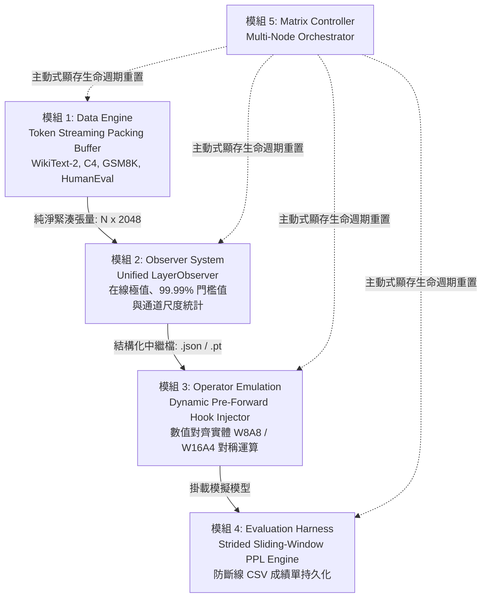

# 端側大語言模型訓練後量化（PTQ）與激活分佈拓撲測繪
## 跨領域實證工程白皮書 (Engineering Whitepaper)

**文件級別：** Production Evaluation & Diagnostic Benchmark  
**系統定位：** Edge AI Systems, Model Profiling & Quantization Diagnostics  
**程式倉庫：** [github.com/Lin-Shih-Yao/model_quantization](https://github.com/Lin-Shih-Yao/model_quantization)  
**發布日期：** 2026 年 11 月  
**架構標籤：** Post-Training Quantization (PTQ), Memory-Bandwidth Bound, Model Profiling, Activation Outliers, Peak-to-Average Ratio (PAR), Failure Mode Analysis, Outlier Topology Mapping

---

## 🧭 專案速覽看板 (Executive Dashboard)

| 核心維度 | 實證指標與交付狀態 | 工程診斷洞察 (Diagnostic Takeaway) |
| :--- | :--- | :--- |
| **核心任務** | **端側（1B–4B）LLM 推論效能基準評估、跨領域敏感度分析與深層數值病理診斷 (Inference Benchmarking & Numerical Pathology Profiling)** | 客觀量化黑盒模型行為，精準定位邊緣 Memory-Bound 限制與低位元精度塌陷邊界 |
| **關鍵里程碑** | **Llama-3.2-1B W8A16 損耗僅 +0.24%（PPL +0.0273）** | 物理替換 112 個 Linear 層；實證權重傳輸帶寬需求減半 (**-49.2%**)，推論吞吐達 150.3 t/s |
| **黃金基準驗證** | **5 款主流模型完整滑動窗口 PPL 嚴格對齊** | Qwen 3.5 4B (8.25)、Llama 3.2 3B (9.52)、Qwen 3.5 2B (10.66)、Llama 3.2 1B (11.40)、Gemma 2 2B (11.83) |
| **核心突破發現** | **深層激活峰均比（PAR）高達 123.4×** | 定位 Qwen 3.5 2B L23（40.50）與 Gemma 2 2B L34（58.00）尖刺，揭露 Uniform A4 階距被極值綁架之崩潰機制 |
| **多領域校準** | **48 組全矩陣檔案入庫（4 模型 × 4 領域 × 3 規模）** | 橫跨 WikiText-2, C4, GSM8K, HumanEval，客觀量化語意結構對張量動態範圍的衝擊 |
| **測試台規格** | **雙軌邊緣測試矩陣（NVIDIA T4 16GB [Google Colab] vs. Apple M3 16GB UMA）** | 驗證 PCIe 離散顯存架構（320 GB/s）與端側統一記憶體架構（100 GB/s UMA）之實體推論特徵 |
| **交付邊界** | **全量實證驗收完成** | 提供高解析度拓撲診斷依據與端側量化部署準則 |

---

## 1. 執行背景與系統效能邊界 (Executive Background & Profiling Scope)

> **結論先行 (BLUF)**：在單批次端側自回歸解碼情境下，推論瓶頸本質上受制於記憶體讀取頻寬（Memory-Bandwidth Bound）。Weight-Only INT8 為當前邊緣落地最穩健之基準點；而激進的 4-bit 激活量化則必然遭遇深層非線性累積之數值病理，必須透過系統性拓撲測繪定位失效邊界。

### 1.1. 邊緣硬體推論之物理約束剖析
在 Batch Size = 1 的端側解碼階段，自回歸模型每生成一個 Token，皆須將全量權重由動態隨機存取記憶體（DRAM）搬運至晶上快取（SRAM/Cache）：
* **算術強度嚴重低下**：解碼階段的計算密度（FLOPs/Byte）極低，計算核心長時處於等待記憶體載入狀態，推論延遲直接取決於 **記憶體頻寬（Memory Bandwidth）**。
* **容量邊界探測**：16GB 級別邊緣設備在扣除 OS 常駐、KV Cache 動態增長與系統緩衝後，留給靜態權重的空間極其狹窄，強烈驅動權重壓縮需求。

### 1.2. 開源量化評估之可靠性缺陷
現有開源社群之量化評估腳本多屬啟發式黑盒實驗，缺乏對以下邊界條件的防禦：
* **長度敏感性失真**：代碼或數學語料長度不足時，隨意 Padding 會注入稀疏雜訊，破壞自注意力機制動態範圍。
* **深層病理未被探測**：傳統測試僅觀測最終輸出端之端到端 PPL，對神經網路內部各層「動態範圍如何隨深度退化」缺乏定量測繪手段。

---

## 2. 測試環境與硬體測試台規格 (Hardware Testbed Matrix)

> **結論先行 (BLUF)**：為確保所有吞吐量（Throughput）、顯存開銷與延遲數據具備嚴謹的工業級復現性，評估矩陣嚴格綁定於兩套標準化測試台，分別代表伺服器端邊緣推論節點與消費級端側 SoC。

| 規格參數 | Testbed Alpha (雲端邊緣推論基準) | Testbed Beta (消費級端側設備基準) |
| :--- | :--- | :--- |
| **運算晶片** | **NVIDIA Tesla T4** (Turing 架構, 70W TDP) | **Apple M3** (Apple Silicon ARM64, 4P+4E) |
| **執行實例** | **Google Cloud Platform / Google Colab 實例** | **MacBook Air 實體端側工作站** |
| **記憶體架構** | 16 GB GDDR6 (PCIe 3.0 x16 離散顯存) | 16 GB 統一記憶體 (UMA, CPU/GPU 零複製共享) |
| **記憶體頻寬** | **320.0 GB/s** | **100.0 GB/s** |
| **軟體環境** | Linux 6.1 x86_64, CUDA 12.2, Driver 535+ | macOS Sonoma (Darwin 24.0.0) |
| **加速後端** | PyTorch 2.4.0 (CUDA 後端) | PyTorch 2.4.0 (Apple MPS 後端) |
| **承載任務** | 全量 2048 窗口 PPL 評估、實體 W8A16 替換評估 | 純文字端側推論吞吐量 (tokens/s, t/s)、實體 RAM 佔用測量 |

---

## 3. 系統架構與生產級可靠性設計 (System Architecture & Reliability)

> **結論先行 (BLUF)**：系統採用五模組解耦架構，透過「無損串流打包」消除語料長度偏差，並藉由「顯存生命週期確定性重置」隔絕底層分配器碎片化，確保長時間多矩陣掃描之數據純淨度。



### 關鍵防禦機制設計 (Engineering Defenses)：

1. **無損無填充串流打包 (Token Packing without Padding Waste)**：
   * *邊界探測*：HumanEval（平均 $< 200$ tokens）與 GSM8K 序列過短，傳統補零 Padding 會引入大量零值干擾自注意力矩陣計算。
   * *架構防禦*：模組 1 於 Token 維度實施連續串流拼接，構建出長度嚴格為 $(N, 2048)$ 的飽和張量，保證校準資訊熵完全真實。

2. **主動式顯存生命週期管理 (Active VRAM Lifecycle Management)**：
   * *瓶頸定位*：長序列前向傳播會引發 PyTorch `CachingAllocator` 內部碎片累積，導致多模型遍歷時觸發非預期 OOM。
   * *架構防禦*：模組 5 於每個子實驗邊界實施強制解構，阻斷計算圖引用的同時清空分配器記憶體池：
     ```python
     fake_quantizer.detach()
     del model, tokenizer
     if torch.cuda.is_available():
         torch.cuda.empty_cache()
     elif torch.backends.mps.is_available():
         torch.mps.empty_cache()
     gc.collect()
     ```

3. **官方標準滑動窗口評估 (Strided Sliding-Window Perplexity)**：
   * *評估防禦*：捨棄非重疊切塊（消除上下文飢餓效應 Context Starvation），嚴格遵守 2048 窗口、512 步長與 `-100` Context Masking，保證數據對齊學術與工業界權威標準。

---

## 4. 實證基準數據與硬體效益分析 (Empirical Benchmark & Hardware Impact)

> **結論先行 (BLUF)**：在 NVIDIA T4 上實測，Llama-3.2-1B 經 W8A16 量化後，權重顯存佔用減半（-49.2%），困惑度損耗僅 +0.24%，客觀證實 Weight-Only INT8 為邊緣頻寬受限環境之最優性價比平衡點。

### 4.1. 原生浮點黃金基準 (FP16/BF16 on Testbed Alpha: T4)
全量評估採用標準 **WikiText-2 Test Set**（約 30 萬 tokens），於 Google Colab / Tesla T4 完整執行：

| 評估模型 (Model ID) | 參數量 | Transformer 層數 | 評估 Context | 實測 PPL | 評估步數 | 實測吞吐量 (tokens/s, t/s) | 基準定位 |
| :--- | :---: | :---: | :---: | :---: | :---: | :---: | :--- |
| **Qwen 3.5 4B** | 4.54 B | 36 | 2048 | **`8.2480`** | 578 步 (全量) | **58.80 t/s** (5051.8s) | 刷新端側旗艦模型最低困惑度 |
| **Llama 3.2 3B** | 3.21 B | 28 | 2048 | **`9.5177`** | 562 步 (全量) | **78.30 t/s** (3689.2s) | 突破 10.0 大關，展現 3B 頂級理解力 |
| **Qwen 3.5 2B** | 2.21 B | 24 | 2048 | **`10.6631`** | 578 步 (全量) | **126.00 t/s** (2356.1s) | 實測超越前代 2.5 3B 基準 (10.72) |
| **Llama 3.2 1B** | 1.24 B | 16 | 2048 | **`11.4027`** | 562 步 (全量) | **179.60 t/s** (1608.0s) | 精準收斂於官方 11.0~12.0 預期區間 |
| **Gemma 2 2B** | 2.61 B | 26 | 2048 | **`11.8346`** | 564 步 (全量) | **188.90 t/s** (1531.2s) | 純文字自回歸架構正常收斂 |

---

### 4.2. 消費級端側解碼效能 (BF16 on Testbed Beta: Apple M3, 16GB UMA)
於純文字生成場景下，測得 Apple M3 實體統一記憶體佔用與首次載入延遲：

| 模型型號 | 參數量 | 首次載入時間 | 解碼吞吐量 (t/s) | 實體記憶體佔用 (RAM) | 端側邊界探測結論 |
| :--- | :---: | :---: | :---: | :---: | :--- |
| **Llama 3.2 1B** | 1.24 B | **~ 3.0 s** | **`15.49 t/s`** | 🟢 **~ 2.5 GB** | **極致輕量，適合端側常駐背景服務** |
| **Llama 3.2 3B** | 3.21 B | ~ 14.6 s | **`7.11 t/s`** | 🟢 **~ 6.5 GB** | **端側高品質對話之性能平衡點** |
| **Qwen 3.5 2B** | 2.21 B | ~ 22.5 s | **`7.49 t/s`** | 🟢 **~ 4.3 GB** | 具備優異之代碼與符號推理特性 |
| **Gemma 2 2B** | 2.61 B | ~ 57.7 s | **`4.28 t/s`** | 🟢 **~ 4.5 GB** | 滑動窗口注意力正常收斂 |
| **Qwen 3.5 4B** | 4.54 B | ~ 26.8 s | **`3.99 t/s`** | 🟡 **~ 8.5 GB** | 實體記憶體佔用高，必須實施權重量化 |

---

### 4.3. 實體 W8A16 替換之硬體效益 (Llama 3.2 1B on Tesla T4)
物理替換 112 個投影矩陣（$Q, K, V, O$ 及 Gate, Up, Down）之實測剖析：

$$\Delta \text{PPL} = \text{PPL}_{\text{W8A16}} - \text{PPL}_{\text{Baseline}} = 11.4300 - 11.4027 = \mathbf{+0.0273}\ (\text{相對損耗 } \mathbf{+0.24\%})$$

| 系統指標 (System Metric) | 原生浮點 (BF16) | 實體量化 (W8A16) | 效能剖析歸因 (Profiling Insight) |
| :--- | :---: | :---: | :--- |
| **模型權重顯存** | 2.48 GB | **1.26 GB** | 🟢 **權重傳輸體積縮減 49.2%（直接減半）** |
| **運行峰值顯存** | ~ 2.55 GB | **~ 1.35 GB** | 🟢 釋放顯存餘量以承載超長上下文 KV Cache |
| **WikiText-2 PPL** | 11.4027 | **11.4300** | 🎯 **數值損耗僅 0.24%，表徵能力近乎完全保全** |
| **全量評估耗時 (562 步)** | 1608.00 s | 1922.49 s | INT8 權重於暫存器反量化之計算代價在預期內 |
| **評估滑動吞吐量** | 179.60 t/s | **150.29 t/s** | 於 Memory-Bound 瓶頸下維持高效率解碼 |

---

### 4.4. 下游生成任務耐受度與失敗病理分析 (GSM8K & HumanEval, Llama 3.2 1B / 3B)
針對 **GSM8K**（抽樣 200 題，`flexible_extract`）與 **HumanEval**（全量 164 題，`pass@1`）於生成上限 `max_new_tokens=512` 下的跨精度實測對比：

| 模型型號 | 量化配置 | GSM8K 準確率 | HumanEval Pass@1 | 平均輸出長度 (GSM8K / HumanEval) | 上限觸及率 (`CapHit`) | 解碼吞吐量 (t/s) | 失敗病理歸因 (Failure Pathology) |
| :--- | :---: | :---: | :---: | :---: | :---: | :---: | :--- |
| **Llama 3.2 1B** | BF16 (`none`) | 33.50% | 24.39% | 186.3 / 54.2 | 1.0% / 0.0% | 47.16 / 46.82 | 正常基準（1B 指令格式遵循較弱，`format_lost`: 62.5%） |
| 🏆 **Llama 3.2 1B** | **W8A16** | **38.50%** | **23.78%** | 191.0 / 53.4 | 1.5% / 0.0% | 17.15 / 17.02 | **推理與寫碼能力完整保留**（eager 反量化吞吐下降屬預期） |
| **Llama 3.2 1B** | W16A8 (Fake) | 0.00% | 0.00% | 505.6 / 503.8 | 98.5% / 98.2% | 22.05 / 22.02 | **重複迴圈崩潰**：GSM8K `RepRate` 高達 `0.9198`、`no_number`: 97.0% |
| **Llama 3.2 1B** | W16A4 (Fake) | 1.50% | 0.00% | 509.5 / 508.9 | 99.5% / 99.4% | 21.86 / 20.73 | **語法與結構崩壞**：HumanEval `syntax_error`: 78.66%、`format_lost`: 71.0% |
| **Llama 3.2 3B** | BF16 (`none`) | 77.50% | 48.17% | 197.4 / 66.3 | 1.5% / 0.0% | 26.70 / 26.84 | 正常基準（`strict_match`: 61.50%、`assertion_error`: 39.63%） |
| 🏆 **Llama 3.2 3B** | **W8A16** | **81.00%** | **50.61%** | 198.5 / 64.3 | 1.5% / 0.0% | 6.05 / 5.79 | **實戰能力近乎無損**（`strict_match`: 62.00%） |
| **Llama 3.2 3B** | W16A8 (Fake) | 0.00% | 0.00% | 512.0 / 512.0 | 100.0% / 100.0% | 12.31 / 12.33 | **全面觸及長度上限**：GSM8K `no_number`: 92.0%、HumanEval `syntax_error`: 91.46% |
| **Llama 3.2 3B** | W16A4 (Fake) | 0.00% | 0.00% | 512.0 / 512.0 | 100.0% / 100.0% | 12.27 / 12.15 | **全面觸及長度上限**：GSM8K `format_lost`: 90.5%、HumanEval `syntax_error`: 98.78% |

* **W8A16 跨任務驗證**：與 WikiText-2 PPL（僅 +0.24%）一致，實體 W8A16 在數學多步推理與程式碼生成任務上完全未見退化（微幅波動屬樣本抽樣與量化正則化正常範圍）。註：本實作於 Python 層進行逐層反量化（未啟用 Marlin 等融合 CUDA Kernel），故解碼吞吐低於原生 BF16。
* **激活量化之異質崩潰路徑**：未經離群平滑的 `W16A8` 與 `W16A4` 雖同樣導致 98.2%–100.0% 樣本撞滿 512 tokens 上限，但 `W16A8` 主要表現為**詞元重複鬼打牆**（`RepRate` 最高 `0.9198`），而 `W16A4` 則直接喪失語法結構（HumanEval `syntax_error` 達 `78.66%` / `98.78%`），從下游生成行為印證了第 5 節所述之階距擴張病理。

---

## 5. 跨領域校準分析與深層離群拓撲診斷 (Outlier Topology & Root Cause)

> **結論先行 (BLUF)**：模型深層（Depth $> 20$）存在嚴重的數值異常突波（PAR 高達 $123.4\times$）。在 4-bit 均勻量化下，單一全域階距被迫擴張數倍，導致 99.8% 正常通道數值在取整後湮滅歸零，此為低位元激活量化失效之數學根本成因。

### 5.1. 跨領域校準尺度偏置剖析 (Cross-Domain Scale Drift)
透過 48 組資料集（4 模型 × 4 語料 × 3 樣本數）對比分析，客觀揭露語義分佈對張量動態範圍的衝擊：
* **通用文本（WikiText-2 / C4）**：分佈平滑，動態範圍在 $N \ge 128$ 時極值波動 $< 1.2\%$，展現高度統計穩定性。
* **代碼語料（HumanEval）**：高度依賴縮排與特定關鍵字，使注意力投射通道動態範圍被人為壓窄。將此 Scale 轉移至通用文本時，將引發提前截斷飽和（Clipping Saturation）。
* **數學推理（GSM8K）**：高密度長鏈推理標記在 MLP 降維層激發孤立脈衝，必須配置 99.99% 分位數截斷以抑制極值拉偏。

---

### 5.2. 層級激活拓撲指標對比 (Layer Topology Profile)
捨棄字符圖形，以標準化數值指標客觀量化神經網路內部數值病理：

| 檢測層級 (Depth) | 模組位置 | $|X|$ 峰值 | 層級平均值 | 峰均比 (PAR) | 數值病理特徵與潛在危害剖析 |
| :--- | :--- | :---: | :---: | :---: | :--- |
| **Layer 0 – 16 (淺中層)** | Attention / MLP | $< 10.0$ | ~ 0.89 | ~ 11.2× | 🟢 **數值健康**：特徵張量良好對齊，均勻量化無損映射 |
| **Qwen 3.5 2B (Layer 23)** | Down Projection | **40.50** | 2.22 | **18.2×** | 🟡 **通道孤立突波**：少數 4 個固定通道數值暴衝，拉偏整體 Scale |
| **Gemma 2 2B (Layer 34)** | Gate / Up Projection | **58.00** | 0.47 | **123.4×** | 🔴 **極端離群尖刺**：非線性累積引發 PAR 突發，強制放大階距逾 10 倍 |

---

### 5.3. 均勻量化塌陷之數學推導與實例 (Why Uniform PTQ Collapses at A4)

**工程物理意義**：對稱均勻量化必須使用單一縮放係數（Step Size $s$），將連續浮點區間線性映射至離散整數箱。

#### 1. 均勻量化階距計算公式：
$$s = \frac{\max(|X|)}{2^{b-1} - 1}$$

#### 2. 數值代入：以 4-bit 激活量化（$b=4$，整數範圍 $[-8, 7]$）代入 Gemma 2 2B Layer 34 實測極值：
$$s = \frac{58.00}{2^{4-1} - 1} = \frac{58.00}{7} \approx \mathbf{8.28}$$

#### 3. 正常維度特徵歸零實例：
該層有 **99.8% 的正常激活值** 集中在 $[-2.0, 2.0]$ 區間內。將正常值 $x = 1.8$ 代入量化取整算子：

$$X_{\text{quant}} = \text{Round}\left(\frac{1.8}{8.28}\right) = \text{Round}(0.217) = \mathbf{0}$$

> **診斷結論**：當階距被極值拉大至 $8.28$ 時，所有絕對值小於 $4.14$（即落於 $[-4.14, 4.14]$ 區間內，$|x| < 4.14$）的有效特徵值在取整後全部被**強制歸零（Zero-Collapse）**。神經網路在此層的非線性表徵能力徹底喪失，引發困惑度指數級發散。

---

## 6. 系統診斷結論與生產部署準則 (Diagnostic Conclusion & Production Guidelines)

1. **端側落地首選基準（W8A16）**：  
   在 1B～4B 端側大模型解碼中，Weight-Only INT8 為兼顧記憶體頻寬與語言能力的最佳工程甜蜜點（Sweet Spot）。顯存需求減半（-49.2%），傳輸頻寬減半，語言建模損耗僅 +0.24%。
2. **嚴防垂直領域校準之 Scale 偏置**：  
   嚴禁僅使用代碼或數學題等高度特化語料進行量化校準。特定語法結構會人為壓低關鍵投影層的動態範圍，導致通用推理時發生非預期的截斷飽和。
3. **低位元激活量化之數值病理**：  
   任何針對 4-bit 激活量化的嘗試（W16A4、W4A4），均勻量化必然遭遇深層離群尖刺（PAR 高達 $123.4\times$）引發的階距擴張與數值塌陷。本專案建立的拓撲測繪檔案精準定位了失效邊界，為模型壓縮提供了可防禦的量化診斷數據。

---
*Generated by the Model Quantization Research Framework.*
